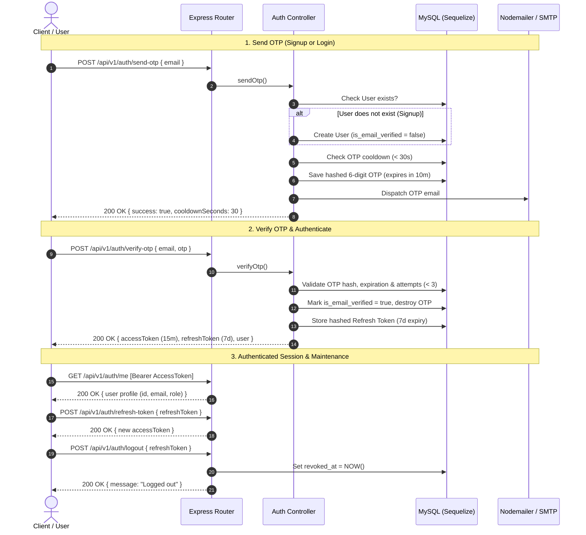

# Technical Requirements Document (TRD) — AstroTring Backend

> **Status:** Active (Phase 1 — Auth & Session Management)  
> **Last Updated:** October 2026  
> **Target Scope:** `backend/` and `shared/`  

---

## 1. Overview & System Objectives

The AstroTring backend provides high-performance, secure REST and real-time APIs for the AstroTring platform. Built on **Node.js (v22+)**, **Express**, and **MySQL** managed with **Sequelize ORM**, the system adheres to strict ES Module standards, stateless JWT sessions with revocable refresh tokens, and robust security protections.

Phase 1 focuses exclusively on **Passwordless Email OTP Authentication** and session management.

---

## 2. Technical Stack

| Layer | Technology | Specifications / Purpose |
| :--- | :--- | :--- |
| **Runtime** | Node.js (v22+) | Native ES Modules (`import`/`export`), non-blocking asynchronous event loop. |
| **Framework** | Express (v4.21+) | Minimalist HTTP server with centralized middleware pipeline. |
| **Database** | MySQL | Relational engine with foreign key indexes and snake_case schema. |
| **ORM** | Sequelize (v6.37+) | Schema definition, connection pooling, soft-deletes (`paranoid: true`), UUID primary keys. |
| **Authentication** | JWT + Bcrypt | 15-minute access tokens, 7-day database-backed refresh tokens, bcrypt hashing (12 rounds). |
| **Communications** | Nodemailer | Transactional email delivery for 6-digit verification codes. |
| **Security & Guardrails**| Helmet, CORS, Rate-Limit | Strict HTTP headers, frontend origin whitelist, rate-limiting (5 req / 15 min per IP). |
| **Dev Tooling** | Nodemon, Dotenv | Auto-reloading in development and centralized environment variables. |

---

## 3. Architecture & Project Layout

The backend uses a modular, layered architecture directly under `backend/`:

```text
backend/
├── .env.example              # Environment variables template
├── package.json              # ES module manifest & scripts
├── server.js                 # HTTP server bootstrap & DB initialization
├── ai/                       # LangGraph Tool-Calling Engine for Vaani & Astropedia
│   ├── tools.js              # 5 Vedic astrology tools with plain JSON Schema
│   ├── state.js              # VaaniStateAnnotation (messages, chartData, birthParams)
│   ├── prompts.js            # System prompts & lightweight user profile generator
│   ├── nodes.js              # agentNode, toolExecutorNode, routeAfterAgent
│   └── graph.js              # Compiled StateGraph with MemorySaver checkpointer
├── config/
│   └── db.js                 # Sequelize connection instance & pool settings
├── models/
│   ├── index.js              # Model associations & re-exports
│   ├── User.js               # `users` table definition
│   ├── Otp.js                # `otps` table definition
│   ├── RefreshToken.js       # `refresh_tokens` table definition
│   ├── BirthChart.js         # `birth_charts` table definition & chart data storage
│   ├── BirthDetail.js        # `birth_details` table definition (user profiles)
│   ├── ChatThread.js         # `chat_threads` table definition
│   └── ChatMessage.js        # `chat_messages` table definition
├── middleware/
│   ├── auth.js               # Bearer JWT verification guard (`protect`, `optionalAuth`)
│   ├── errorHandler.js       # Centralized error handler & response standardizer
│   └── rateLimiter.js        # IP rate limiting configuration
├── controllers/
│   ├── authController.js     # Auth endpoint handlers (send-otp, verify-otp, me)
│   ├── onboardingController.js # Onboarding submission and status check
│   ├── vedicController.js    # Unified Vedic astrology & calculators controller
│   └── chatController.js     # Vaani & Astropedia SSE chat controller
├── services/
│   ├── vedicAstrologyService.js # Client for Jagannatha Hora calculations & Redis cache
│   └── chatService.js        # Service delegating conversational turns to ai/graph.js
├── routes/
│   ├── authRoutes.js         # Endpoint declarations under `/api/v1/auth`
│   ├── onboardingRoutes.js   # Endpoint declarations under `/api/v1/onboarding`
│   ├── vedicRoutes.js        # Single unified endpoint tree under `/api/v1/vedic`
│   └── chatRoutes.js         # Chat endpoints under `/api/v1/chat`
└── utils/
    ├── appError.js           # Custom operational AppError class
    ├── asyncHandler.js       # Promise-based wrapper for async route handlers
    ├── bcrypt.js             # Hashing and comparison helpers
    ├── cache.js              # Redis cache client with fallback
    ├── jwt.js                # Access & refresh token sign/verify utilities
    └── mailer.js             # Nodemailer transporter & HTML OTP dispatch
```

---

## 4. Database Schema (Phase 1 & Onboarding)

All tables use `snake_case` column naming, UUIDv4 primary keys, timestamps (`created_at`, `updated_at`), and paranoid soft-delete (`deleted_at`).

### 4.1 `users`
| Column | Type | Constraints | Description |
| :--- | :--- | :--- | :--- |
| `id` | UUID | PRIMARY KEY | Unique user identifier (UUIDv4) |
| `email` | VARCHAR(255) | UNIQUE, NOT NULL | Validated email address |
| `is_email_verified` | BOOLEAN | DEFAULT FALSE | Email verification status |
| `onboarding_completed` | BOOLEAN | DEFAULT FALSE | Two-step onboarding status flag |
| `role` | ENUM('user', 'admin') | DEFAULT 'user' | Access control level |
| `created_at` | TIMESTAMPTZ | NOT NULL | Record creation timestamp |
| `updated_at` | TIMESTAMPTZ | NOT NULL | Last update timestamp |
| `deleted_at` | TIMESTAMPTZ | NULLABLE | Soft deletion timestamp |

### 4.2 `birth_details`
| Column | Type | Constraints | Description |
| :--- | :--- | :--- | :--- |
| `id` | UUID | PRIMARY KEY | Unique birth detail profile ID |
| `user_id` | UUID | FK -> `users(id)` | Owning user account reference |
| `profile_type` | VARCHAR(30) | DEFAULT 'self' | Profile categorization ('self', 'family', etc.) |
| `is_primary` | BOOLEAN | DEFAULT TRUE | Primary profile flag for account owner |
| `full_name` | VARCHAR(100) | NOT NULL | Native's full name |
| `gender` | ENUM | NOT NULL | 'male', 'female', 'other' |
| `date_of_birth` | DATE | NOT NULL | Date of birth (YYYY-MM-DD) |
| `time_of_birth` | VARCHAR(10) | NOT NULL | Time of birth (HH:MM or HH:MM:SS) |
| `is_time_unknown` | BOOLEAN | DEFAULT FALSE | Exact birth time uncertainty toggle |
| `birth_city` | VARCHAR(150) | NOT NULL | Human-readable city / location |
| `latitude` | DECIMAL(9,6) | NOT NULL | Decimal latitude coordinate |
| `longitude` | DECIMAL(9,6) | NOT NULL | Decimal longitude coordinate |
| `timezone` | DECIMAL(4,2) | NOT NULL | UTC timezone offset in hours |
| `chart_id` | UUID | FK -> `birth_charts(id)` | Automatically computed initial natal chart |
| `created_at` | TIMESTAMPTZ | NOT NULL | Record creation timestamp |
| `updated_at` | TIMESTAMPTZ | NOT NULL | Last update timestamp |
| `deleted_at` | TIMESTAMPTZ | NULLABLE | Soft deletion timestamp |

### 4.2 `otps`
| Column | Type | Constraints | Description |
| :--- | :--- | :--- | :--- |
| `id` | UUID | PRIMARY KEY | Unique OTP transaction ID |
| `user_id` | UUID | FK -> `users(id)` | Associated user reference |
| `otp_hash` | VARCHAR(255) | NOT NULL | Bcrypt hash of the 6-digit OTP |
| `purpose` | VARCHAR(50) | DEFAULT 'auth' | Purpose identifier |
| `expires_at` | TIMESTAMPTZ | NOT NULL | Expiration timestamp (10 minutes) |
| `attempts` | INTEGER | DEFAULT 0 | Failed verification count (max 3) |
| `created_at` | TIMESTAMPTZ | NOT NULL | Record timestamp |
| `deleted_at` | TIMESTAMPTZ | NULLABLE | Soft delete / consumption flag |

### 4.3 `refresh_tokens`
| Column | Type | Constraints | Description |
| :--- | :--- | :--- | :--- |
| `id` | UUID | PRIMARY KEY | Token identifier |
| `user_id` | UUID | FK -> `users(id)` | Associated user reference |
| `token_hash` | VARCHAR(255) | NOT NULL | Bcrypt hash of the issued refresh token |
| `expires_at` | TIMESTAMPTZ | NOT NULL | Expiry timestamp (7 days) |
| `revoked_at` | TIMESTAMPTZ | NULLABLE | Revocation timestamp (logout/rotation) |
| `created_at` | TIMESTAMPTZ | NOT NULL | Issue timestamp |
| `deleted_at` | TIMESTAMPTZ | NULLABLE | Soft delete timestamp |

---

## 5. Authentication Flow & Lifecycle



---

## 6. API Specifications (Base URL: `/api/v1`)

### Standard Response Format
```json
{
  "success": true,
  "message": "Human readable status message",
  "data": {},
  "error": {}
}
```

### Endpoints Matrix
| Method | Path | Auth Required | Description |
| :--- | :--- | :--- | :--- |
| `POST` | `/api/v1/auth/send-otp` | No (Rate-limited) | Checks email; creates unverified user if new, generates & sends 6-digit OTP. |
| `POST` | `/api/v1/auth/verify-otp` | No (Rate-limited) | Verifies OTP code, validates attempts, issues access + refresh tokens. |
| `POST` | `/api/v1/auth/refresh-token` | No (Rate-limited) | Validates active refresh token from DB and issues new 15-minute access token. |
| `POST` | `/api/v1/auth/logout` | No | Revokes active refresh token (`revoked_at = NOW()`). |
| `GET` | `/api/v1/auth/me` | Yes (Bearer JWT) | Returns current authenticated profile (`id`, `email`, `role`, `createdAt`). |

---

## 7. Security & Non-Functional Protocols

1. **Passwordless Integrity**: Password hashes, passwords, and reset flows are completely eliminated in favor of single-use, hashed OTP codes.
2. **Brute-Force & Flood Protection**:
   - `express-rate-limit` throttles all auth routes to a strict **5 requests / 15 minutes** per IP address.
   - OTP resend requests enforce a **30-second cooldown** per account.
   - OTP verification attempts lock down after **3 consecutive failed attempts**.
3. **Token Management**:
   - **Access Token**: Short-lived (15 minutes), signed with `JWT_ACCESS_SECRET`.
   - **Refresh Token**: Long-lived (7 days), signed with `JWT_REFRESH_SECRET`, stored as a **bcrypt hash** in the database.
4. **Data Privacy**: Tokens, plain OTPs, and sensitive stack traces are never exposed to clients in production environments.
5. **CORS Security**: Whitelisted exclusively to configured `FRONTEND_URL`.
